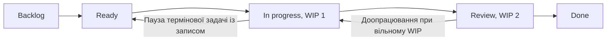

# Kanban-дошка, навчальний сценарій ЛР4

**Табачук Олександр · КН-42 · V06 · бронювання аудиторій та обладнання**  
**Період моделювання:** 2026-10-15 — 2026-10-29. Дошка є публічним Markdown-артефактом після коміту, а не автоматично синхронізованим GitHub Projects. Реальні часові мітки в GitHub потрібно буде накопичувати окремо.

**Policy:** `Backlog → Ready → In progress → Review → Done`, WIP `In progress`: 2 до 19 жовтня, **1 починаючи з 20 жовтня**; WIP `Review`: 2. `Blocked` — позначка стану роботи, а не окрема колонка; припинена через терміновість картка може тимчасово повернутися до `Ready`, зі збереженням першої дати старту.

## Стан на 2026-10-29

| Backlog | Ready | In progress (WIP 1) | Review (WIP 2) | Done |
| --- | --- | --- | --- | --- |
| — | **F-012** Експорт у календар | **F-011** Матриця ролей | — | **F-001** Перевірка залежностей |
| | | | | **F-002** Тестовий контракт розкладу |
| | | | | **F-003** Критерії пошуку |
| | | | | **F-004** Конфлікти інтервалів |
| | | | | **F-005** Два кроки заявки |
| | | | | **F-006** Статус відхиленої заявки |
| | | | | **F-007** Перевірки погодження |
| | | | | **F-008** Термінове усунення дублювання |
| | | | | **F-009** Резервний сценарій розкладу |
| | | | | **F-010** Чекліст наскрізної демонстрації |

### Потік та правила витягування

## Картки: власник, пріоритет, дедлайн, критерій приймання

У всіх задачах власник — **Олександр Табачук, навчальна роль PM/PO**. Пріоритет `P0` має лише термінове виправлення, що з’явилося після конверта 2. Документальні приклади завершених робіт — [EVIDENCE.md](./EVIDENCE.md). У таблиці наведено не доказ наявності реалізованого ПЗ, а **критерій завершення навчальної роботи з прототипом**.

| Ключ | Завдання / пов’язана історія | Пріоритет | Дедлайн | Стан | Критерій приймання |
| --- | --- | --- | --- | --- | --- |
| `F-001` | Перевірити зовнішні залежності до Sprint Planning (`Ретроспектива ЛР3`) | P1 | 2026-10-17 | Done | Чекліст залежностей має відповідального, дедлайн та доказ доступу або задокументований статус blocked; S-09 не включено у committed sprint backlog. |
| `F-002` | Описати тестовий контракт даних розкладу (`S-09 (підготовча робота)`) | P1 | 2026-10-19 | Done | Є тестова схема полів та список питань до власника API; реальний доступ до розкладу не заявляється. |
| `F-003` | Уточнити критерії пошуку вільної аудиторії (`S-03`) | P1 | 2026-10-21 | Done | Сформульовано три перевірки пошуку за датою, часом і місткістю на демонстраційних даних. |
| `F-004` | Змоделювати конфлікти часових інтервалів (`S-03/S-04`) | P1 | 2026-10-20 | Done | Описано три сценарії накладання інтервалів та очікувані результати відбору кімнат. |
| `F-005` | Розбити спільну заявку на два зрозумілі кроки (`S-04`) | P1 | 2026-10-22 | Done | Макет показує вибір аудиторії та обладнання в одній заявці й окрему перевірку повноти. |
| `F-006` | Виправити некоректний статус після відхилення (`S-07`) | P1 | 2026-10-23 | Done | У сценарії макета після відхилення відображаються статус «Відхилено» та причина, а не «Погоджено». |
| `F-007` | Описати перевірки черги погоджувача (`S-06`) | P2 | 2026-10-26 | Done | Є тестові кроки погодження і відхилення; перерва через термінову картку позначена. |
| `F-008` | Терміново прибрати дублювання заявки в прототипі (`S-04`) | P0 | 2026-10-25 | Done | Для повторного натискання «Надіслати» описаний алгоритм недопущення дубля і перевірка одного результату; це не запущений код. |
| `F-009` | Визначити резервний сценарій без інтеграції (`S-09`) | P2 | 2026-10-27 | Done | За відсутності актуального розкладу прототип має явну позначку «тестові дані»; реальні бронювання заблоковано. |
| `F-010` | Підготувати наскрізний чекліст демонстрації (`S-03/S-04/S-06/S-07`) | P2 | 2026-10-28 | Done | Чекліст перевіряє маршрут «пошук → заявка → погодження → статус», не видаючи макет за реліз. |
| `F-011` | Уточнити правила ролей заявника й погоджувача (`S-02`) | P2 | 2026-10-30 | In progress | Матриця дій ролей створюється; потрібен перегляд винятків перед Review. |
| `F-012` | Підготувати сценарій експорту в календар (`S-10`) | P3 | 2026-11-03 | Ready | Для старту погоджено формат події; перевірка передбачається після початку роботи. |

## Журнал переходів (модельовані події)

У записах нижче фіксується **послідовність зміни станів**, а не справжня історія з API трекера. У межах однієї дати порядок подій відповідає порядку рядків.

| Дата | Картка | Подія / перехід | Чому це важливо |
| --- | --- | --- | --- |
| 2026-10-15 | F-001…F-004 | Backlog → Ready | Підготовано першу чергу роботи після ЛР3. |
| 2026-10-16 | F-001, F-002 | Ready → In progress | Два зайняті слоти, WIP 2/2. |
| 2026-10-17 | F-001 | In progress → Review → Done | Чекліст залежностей створено; S-09 без підтвердження лишено blocked. |
| 2026-10-17…18 | F-002 | Blocked у роботі (2 дні) | Немає зразка даних зовнішнього розкладу; реального доступу не підтверджено. |
| 2026-10-18 | F-003 | Ready → In progress | Після завершення F-001 є один вільний слот. |
| 2026-10-19 | F-002 | In progress → Review → Done | Тестовий контракт описано без претензії на інтеграцію. |
| 2026-10-19 | F-004 | Ready → In progress | У роботі F-003 і F-004, ліміт 2/2. |
| 2026-10-19 | F-005 | Backlog → Ready | Картка готова до витягування, але немає вільної ємності. |
| 2026-10-20 | F-006 | Backlog → Ready | Критерій відхилення заявки сформульований до старту. |
| 2026-10-20 | F-003, F-004 | **Конверт 1: WIP 2 → 1** | Нові задачі не беруться, поки попередні не звільнять слот. |
| 2026-10-20 | F-005 | Вперше чекає в Ready через WIP | Замість старту підготовлено критерій перевірки. |
| 2026-10-20 | F-004 | In progress → Review → Done | Відпрацьовано перевірку конфліктів інтервалів. |
| 2026-10-21 | F-003 | In progress → Review → Done | Звільнено єдиний слот WIP. |
| 2026-10-21 | F-005 | Ready → In progress | Взято лише після завершення F-003. |
| 2026-10-21 | F-007 | Backlog → Ready | Підготовлено критерій для черги погодження. |
| 2026-10-22 | F-009 | Backlog → Ready | Початок очікування резервного сценарію в черзі Ready. |
| 2026-10-22 | F-005 | In progress → Review → Done | Перевірено двокроковий сценарій. |
| 2026-10-22 | F-006 | Ready → In progress | Один зайнятий слот. |
| 2026-10-23 | F-006 | In progress → Review → Done | Усунено помилку статусу в макеті. |
| 2026-10-23 | F-007 | Ready → In progress | Один зайнятий слот. |
| 2026-10-24 | F-008 | Створено → Ready (термінова) | Конверт 2; виникла проблема повторного надсилання. |
| 2026-10-24 | F-007 | In progress → Ready, пауза | Явно звільнили єдиний слот; тривалість паузи 1 день. |
| 2026-10-24 | F-008 | Ready → In progress | Взято термінову задачу, WIP 1/1. |
| 2026-10-25 | F-010 | Backlog → Ready | Наскрізний чекліст готовий до витягування. |
| 2026-10-25 | F-008 | In progress → Review → Done | Критерій відсутності дубля виконано у сценарії. |
| 2026-10-25 | F-007 | Ready → In progress (відновлено) | Перша дата старту 23-го не змінюється. |
| 2026-10-26 | F-007 | In progress → Review → Done | Перевірки черги погоджувача готові. |
| 2026-10-26 | F-009 | Ready → In progress | Після 4 календарних днів очікування в Ready. |
| 2026-10-27 | F-009 | In progress → Review → Done | Задокументовано резервну поведінку без API. |
| 2026-10-27 | F-011 | Backlog → Ready | Погоджено опис роботи над матрицею ролей. |
| 2026-10-27 | F-010 | Ready → In progress | Єдиний слот зайнято. |
| 2026-10-28 | F-010 | In progress → Review → Done | Демонстраційний чекліст готовий. |
| 2026-10-28 | F-012 | Backlog → Ready | Експорт у календар ще не взято в роботу. |
| 2026-10-28 | F-011 | Ready → In progress | Нова робота в межах WIP=1. |
| 2026-10-29 | F-011, F-012 | F-011 лишається In progress; F-012 лишається Ready | На дату зрізу обидві незавершені, Done не ставимо. |

## Як перевірити модель

- **12 карток:** ключі `F-001`…`F-012` без пропусків є у `README.md` і `cards.csv`; у підготовчому `flow_ready_for_lr14.csv` лише `F-001`…`F-010`, оскільки решта ще не Done.
- **WIP:** до 2026-10-20 максимум 2 одночасно в `In progress`; з 2026-10-20 не беруть нові картки, доки не звільнено місце для WIP=1. Призупинену `F-007` повернено в Ready до витягування `F-008`.
- **Cycle time:** різниця календарних дат (`Done` − перший `In progress`) тільки для Done; зупинку `F-007` не віднімаємо від cycle time, але рахуємо в blocked_days.
- **Межа моделі:** `S-09` не стала працюючим підключенням до розкладу, розглянуто лише рішення про перевірку доступу та резервний режим.

Повернутися до [звіту ЛР4](./README.md).
