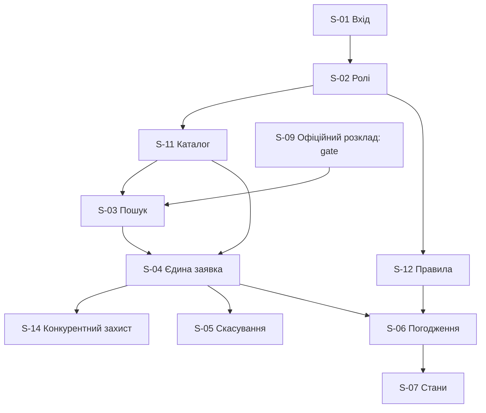

# Релізний план, залежності й межі MVP

**V06:** 20 тижнів до першого релізу · 10 двотижневих спринтів · 20 SP/спринт · бюджет 1 440 000 грн.  
**Статус:** початкове планування до оцінки story points; це не підтвердження дати запуску.

## 1. Що вважаємо «першим релізом»

**Планований безпечний результат:** заявник автентифікується, знаходить ресурс і подає єдину заявку; погоджувач вирішує її за правами; стан видимий; конфлікти й повторні одночасні запити блокуються; скасування повертає ресурс у доступність. Власник розкладу має підтвердити джерело зайнятості до живого запуску.

**Базовий MVP:** `S-01`, `S-02`, `S-03`, `S-04`, `S-05`, `S-06`, `S-07`, `S-11`, `S-12`, `S-14`.  
**Безпековий gate:** `S-09` (офіційний розклад) — **зовнішня залежність не закрита**. Для демонстрації з тестовими даними `S-09` може бути замінена явним навчальним режимом; для реального підтвердження бронювань такої заміни недостатньо.

**Після ядра:** `S-15`, `S-16`, `S-17`, `S-18`; за потреби InfoSec `S-16` переходить у Must із фіксацією зміни обсягу.  
**Після першого релізу:** `S-08`, `S-10`, `S-13` — відповідно серії бронювань, експорт календаря та аналітика.

## 2. Як рахувати місткість

| Показник | Значення | Що означає |
| --- | ---: | --- |
| Горизонт | 20 тижнів | Жорстке обмеження V06 |
| Довжина ітерації | 2 тижні | Гібридний підхід ЛР2 |
| Кількість ітерацій | 10 | 20 / 2 |
| Стартова ємність | 20 SP / ітерацію | Планова, не фактична velocity |
| Теоретичний максимум | 200 SP | 10 × 20 до відрахування ризиків і перерв |
| Планові SP по історіях | Не оцінено | Предмет ЛР8, зараз не вигадуються |

У резерві мають залишатися час на валідацію, інтеграцію, дефекти та пілот; 200 SP **не можна** трактувати як дозвіл автоматично взяти 200 SP з нових історій. Після ЛР8 визначити суму SP кандидатів MVP і переоцінити ризик непоміщення у 20 тижнів.

## 3. Рекомендовані інкременти (не фінальна розкладка SP)

| Вікно | На чому фокус | Умова завершення |
| --- | --- | --- |
| W1–W2 | Discovery, ролі S-02, каталог S-11, джерела даних і доступи S-09 | Власник даних відповів; узгоджено сценарій показу на тестових даних |
| W3–W4 | Вхід S-01, правила S-12, структури ресурсів | Відтворювані тести прав та каталогу |
| W5–W6 | Пошук S-03, перевірка доступності, рішення щодо інтеграції S-09 | Gate W6: доступ і якість джерела **так/ні**, письмове рішення PO |
| W7–W10 | Заявка S-04, захист від подвійної броні S-14, скасування S-05 | Тест конкурентних запитів і конфліктів успішний |
| W11–W14 | Погодження S-06, стан S-07, наскрізне UX-тестування | Тестова заявка проходить від створення до рішення і статусу |
| W15–W18 | Перевірки захисту, якість, критичні Should за погодженням | Немає blocker-дефектів, ризики перераховано |
| W19–W20 | Пілот за умов інформаційної безпеки, демонстрація, приймання | Критерії статуту підтверджені доказами; якщо gate не пройдено — no-go |

Ця таблиця показує **послідовність робіт, не фіксує фактичне виконання**. Кожен спринт формують окремо за пріоритетом, Ready, оцінками SP і доступною ємністю команди.

## 4. Залежності

Відмінність **rank** і **dependency order** є свідомою: найвища за цінністю історія може чекати першочергової низькорейтингової технічної передумови.

## 5. Рішення у випадку відсутності API до W6

1. Підтвердити власника API/джерела, технічний контракт, свіжість, перелік полів і спосіб тестування (`F-001`, `F-002`, `F-009` ЛР4).
2. Якщо до W6 немає підтвердження — заблокувати **живе** бронювання; дозволити тільки демонстрацію на явно позначених тестових даних.
3. Повідомити спонсору і PO: умову першого релізу не виконано; погодити або продовження підготовчих робіт у межах бюджету, або перенесення продуктивного пілоту (не видавати тестове демо за реліз).
4. На ЛР8 оцінити наслідки для місткості, а на ЛР7 — для критичного шляху.

## 6. Як пов'язано з ЛР5 і ЛР4

У ЛР5 заявлені показники пілоту G-01…G-06 (0 конфліктів у контрольних сценаріях, видимі статуси, строк/бюджет). У ЛР6 це простежується до S-03/S-04/S-09/S-14 (конфлікти), S-06/S-07 (статуси), а у ЛР4 моделювався лише потік **підготовчих задач**, не готовий продукт.
